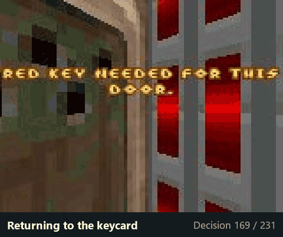

# DoomRay PPO

DoomRay PPO is a ViZDoom agent for **DevForge Track 1 · Can It Play DOOM?** Its policy learns to move, turn, interact and fire from live gameplay. The competition entry is **C749** (Progression C, run 43, update 749). Its training lineage contains 324,864 simulator transitions and 7,614 PPO optimizer steps. [Frozen model and code](https://github.com/Anant-vj/doomray-ppo/tree/6c2d5499f973c77b4a239f778837280edf64e57b)

## Watch C749 recover a key



These are the final **7.31 seconds** of a recorded backtracking drill. The red keycard was behind the spawn. C749 collected it at decision **177**, unlocked the door at **211** and exited at **231**. Seed **3102** was selected for this demonstration after the diagnostic trials. It was the only success in three attempts on this layout. [Recorded events](https://github.com/Anant-vj/doomray-ppo/blob/e9fe1740994a78b3bfb650017061b8e832d7a957/assessment/demos/c749-demonstration-runs/Backtracking-20261127-040413648/audit-report.json)

## What the evaluator runs

The organizer takes the latest commit on the default branch at the submission deadline. From that checkout, `DoomAgent` loads `submission/weights/policy.pt`. The model, policy and training source are all on `main`. [Agent entry point](submission/agent.py) · [Official scoring rules](https://github.com/Reinforce-SST/devforge-doom-template/blob/main/docs/EVALUATION.md)

At each decision the policy encodes 64 rays around the player, pools visible entities and reads player vitals and the previous action. A feed-forward layer combines the current observation’s features with those from the previous three decisions. Six categorical heads sample movement, strafe, turn, attack, use and weapon selection, producing the nine-button action expected by the wrapper. [Policy implementation](submission/policy.py) · [PPO trainer](training/ppo.py)

## What the tests showed

| Test | Result |
| --- | --- |
| Controlled keycard routes | C749 reached the exit in 3/3 straight-route trials and 1/3 backtracking trials. |
| Original locked holdout | C749 survived 0/8 episodes and recorded zero keys, unlocks and exits. |
| Independent examination | Three models played the same 16 unfamiliar Freedoom layouts, two seeds each. All 41,035 decisions were legal. Across 96 episodes, no model collected a key, unlocked a door or reached an exit. |
| Matched key-recovery follow-up | U845 exited 7/8 times overall versus 4/8 for C749, including 4/4 versus 1/4 on key-return layouts. Each exited one of the two guarded-court runs. On the seed where C749 exited, U845 died. |

C749 ranked first on the local development score used to select the submission. In the independent examination, **Stack-26 u621** scored higher on the local balanced measure (**10.542 vs 9.895**) and survived more often (**8/32 vs 3/32**). U845 later improved key recovery but missed the requirement to preserve earlier successful routes. C749 remains the selected entry. The organizers’ hidden-map score and ranking are unknown. [Development results](https://github.com/Anant-vj/doomray-ppo/blob/6c2d5499f973c77b4a239f778837280edf64e57b/README.md#checkpoint-selection) · [Independent assessment](https://github.com/Anant-vj/doomray-ppo/tree/e9fe1740994a78b3bfb650017061b8e832d7a957/assessment) · [U845 paired results](https://github.com/Anant-vj/doomray-ppo/blob/fc69c00d43479dd93baeb0f399e15647629d8b9f/research/key-recovery-u845/matched-results.md)

Combat accuracy and movement bias limit C749 on unfamiliar layouts. Across its 32 independent episodes, it strafed left on 92% of decisions and right on 1.9%. The player counters recorded 8 hits and 66 damage dealt. The engine counted 58 kills without establishing who caused them. [Action and combat measurements](https://github.com/Anant-vj/doomray-ppo/blob/e9fe1740994a78b3bfb650017061b8e832d7a957/assessment/reports/observed-runtime-comparison.json)

## Run the validator

With Git LFS and the competition Python 3.13 environment available, run the following.

```bash
git clone https://github.com/Anant-vj/doomray-ppo.git
cd doomray-ppo
git lfs pull
python validate.py --device cpu
```

The frozen C749 release passed the native Windows validator. In the independent examination its CPU inference averaged **2.22 ms** per decision, with **8.84 ms** at the 99th percentile over 11,446 decisions. The official Linux Docker image and scorer GPU remain unverified. [Native validator log](https://github.com/Anant-vj/doomray-ppo/blob/fc69c00d43479dd93baeb0f399e15647629d8b9f/research/key-recovery-u845/logs/validator-C749.txt) · [Environment and Docker instructions](docs/SUBMISSION.md)

**C749 weight SHA-256** `0b8f290cfe36a25f8593da925d4a4a0ddb8790b37f9319a019aed276a73f5e61`

[Training guide](training/LOCAL.md) · [Agent contract](docs/CONTRACT.md) · [Research archive](https://github.com/Anant-vj/doomray-ppo/tree/4bfd9e2fdbf9e09da6d02fff246d40a1e1aa15a6/research)
